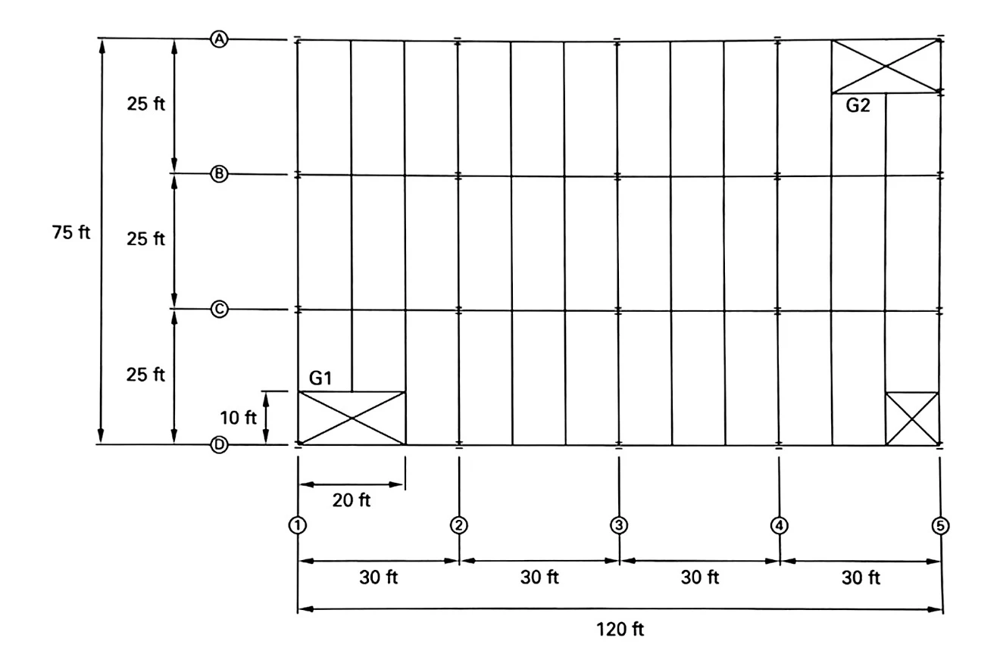

## Reading a structure

Developed for Structural Systems I at Lawrence Technological University, Structure Lab gives students practice identifying what supports a space, choosing how to frame it, and communicating the design assumptions. The course places less emphasis on hand calculation. When a calculation is needed, students define the question and interpret what the result means for the building.

Students begin with a member they can point to. In *Terminology*, they can pick a beam in a three-dimensional frame and switch to a diagram of its behavior. In *Fundamentals*, they can change a load or a support and compare two trials. Amplified deformation makes it possible to see which members stretch, shorten, or bend.

## Three building projects

### Wood Building

How far apart can the purlins be under a mass-plywood roof panel? Students identify the panel's supports and snow load, select the matching cell in the original lecture table, and read the allowable clear span in feet. Applying that value lets them compare the limit with the actual spacing in their roof. They can then check whether each purlin lands at a truss panel point. The roof, truss, floor, and whole-building views keep those decisions connected.

### Steel Building

Students carry one building through roof framing, a partial floor, and columns and foundations. Leaving a bay open creates a double-height space and changes which floor beams deliver reactions to the columns below. Students select composite deck and wide-flange members, trace the roof and floor reactions at a column, and examine its spread footing and pedestal against the lecture detail. The course also introduces piles, pile caps, and grade beams.

### Concrete Building

The four precast schemes (Alpha, Charlie, Delta, and Kilo) share a 60 × 120 ft footprint. Each gives students a different set of components. Students lay out the supports, choose spans, and consult the original span/load tables to select members. The model identifies provisional sections while choices are still open. Students can export a 16:9 report showing the highlighted tables alongside plans, a tributary-area view, a section, and the assembly sequence.

## Exam 2 Review

The review opens at the individual question. Part 1 revisits 30 priority questions from Exam 1. After a student submits a choice, the feedback explains each option, including correct choices they missed. For the Dulles Airport section, students can open Lecture 5, slide 44, on the question page and compare the labels on the suspended roof and its inclined supports. Part 2 contains the full Exam 1 guide with 75 questions and 12 optional calculations.

Part 3 contains 20 ARE-style structures questions. Ten use the same two-story steel office. Students can switch between the original framing plan, a model plan, and a rotatable 3D frame. In Question 20, they compare the floor beams framing into four candidate girders to decide which girder carries the greatest floor load.

<figure>
  
  <figcaption>ARE practice office. Floor beams span 25 ft and are spaced 10 ft on center. At the opening near grid 1D, follow the interrupted beam to G1.</figcaption>
</figure>

## Structure Coach

During a building project, a student can bring a selected member into Structure Coach and turn “Is this beam deep enough?” into a question that identifies the span, supports, loads, material, and performance criterion. Students can take that prompt to their own Gemini session for calculation, then compare the result with their model and source table.

During exam review, the Coach opens with the current question, the student's response, the course explanation, and the referenced lecture pages. Students can ask why a particular option is wrong or request a hint for the next step. **Save study** downloads a local file with the model, notes, and exam progress. **Open study** restores it for the next session.
